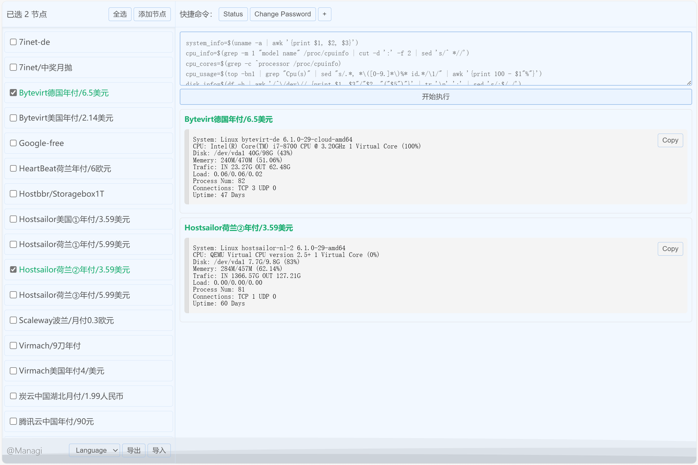
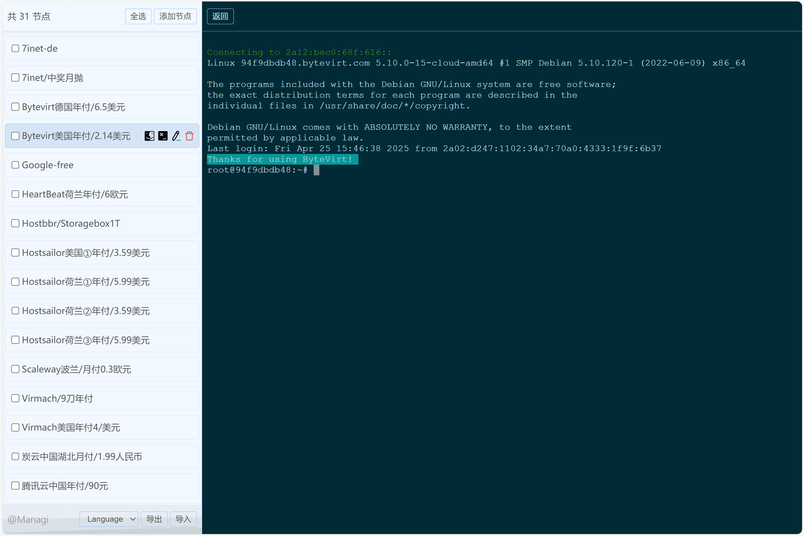
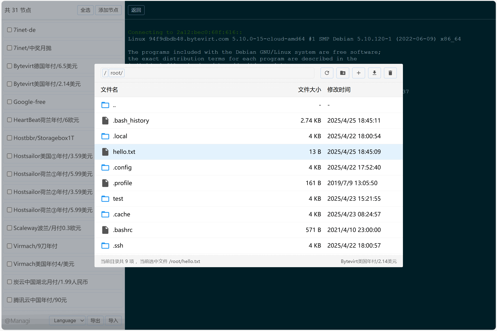

# Managi

[](https://opensource.org/licenses/MIT)
[](./README-zh.md)

Managi is a lightweight, web-based SSH management tool. Simple and easy to use, supports batch command execution, SFTP file management, and SSH terminal, making your operations easier.






## Quick Start

### 1. Run Client Locally

#### Windows Desktop

Download the precompiled `.exe` file:

> The Windows application is automatically compiled via GitHub Actions, ensuring a transparent build process you can trust. [Download now](https://github.com/hochenggang/managi-backend/releases/)

Or build from source:

```bash
git clone https://github.com/hochenggang/managi-backend.git
cd managi-backend
pip install -r requirements.txt
pip install nuitka pystray pillow
nuitka --standalone --onefile --windows-console-mode=disable --windows-icon-from-ico=icon.ico --include-package=PIL --include-package=uvicorn --include-package=fastapi --include-package=pystray --include-data-file=index.html=index.html --include-data-file=icon.ico=icon.ico win-app.py
```

### 2. Run Web Version on Server

#### Docker Deployment

```bash
# Clone and build
git clone https://github.com/hochenggang/managi-backend.git
cd managi-backend
docker build -t managi:latest .

# Disable BasicAuth
docker run -d --network host -e MANAGI_BASICAUTH_ENABLED=false managi:latest

# Custom port and BasicAuth
docker run -d --network host \
  -e MANAGI_PORT=8080 \
  -e MANAGI_BASICAUTH_ENABLED=true \
  -e MANAGI_BASICAUTH_USERNAME=admin \
  -e MANAGI_BASICAUTH_PASSWORD=your_password \
  managi:latest

```


## Key Features

- **Minimalist Design**: A clean, focused interface with minimal resource consumption, making it suitable for teams and individuals of all sizes.
- **Batch Command Execution**: Execute commands across multiple servers with a single click—such as changing passwords or updating system packages—significantly boosting operational efficiency.
- **Web SSH Terminal**: Manage multiple servers directly from your browser, with all data securely stored locally. Supports SSH connections via both password and key authentication.
- **User-friendly file management**: View, upload, and download files directly in the browser.

## Configuration

### ServerConfig

| Environment Variable | Default | Description |
|---------------------|---------|-------------|
| `MANAGI_HOST` | 0.0.0.0 | Bind address |
| `MANAGI_PORT` | 18001 | Service port |
| `MANAGI_LOG_LEVEL` | error | Log level |
| `MANAGI_SSH_TIMEOUT` | 15 | SSH timeout in seconds |
| `MANAGI_KEEPALIVE` | 30 | Keepalive interval in seconds |

### BasicAuthConfig

| Environment Variable | Default | Description |
|---------------------|---------|-------------|
| `MANAGI_BASICAUTH_ENABLED` | true | Enable BasicAuth |
| `MANAGI_BASICAUTH_USERNAME` | admin | BasicAuth username |
| `MANAGI_BASICAUTH_PASSWORD` | admin | BasicAuth password |


## Contribution Guidelines

We welcome contributions of any kind! If you encounter any issues or have suggestions for improvement, feel free to submit an [Issue](https://github.com/hochenggang/managi-backend/issues) or a [Pull Request](https://github.com/hochenggang/managi-backend/pulls).

## License

This project is open-sourced under the [MIT License](LICENSE), allowing you to freely use, modify, and distribute it.
